# Sky_View

**See what is happening around the places you care about.**

Sky_View is a Windows desktop app that puts live public data on a detailed 3D globe: weather alerts,
earthquakes, aircraft, ships, satellites, fires, traffic cameras, road traffic, launches, radio and more. It runs
entirely on your computer. There is no server and no account, and the core features need no API keys.

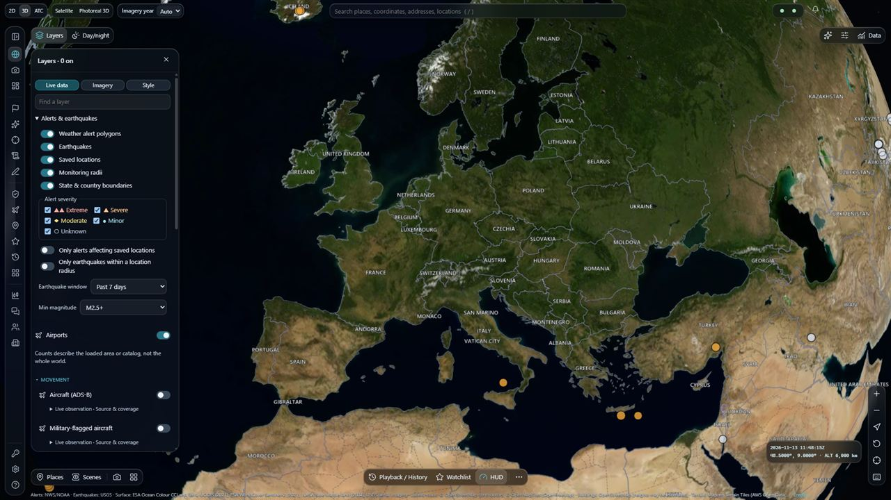

> Sky_View is a public-data monitoring tool. It is **not** an official warning service, a live satellite feed,
> or a people-tracking tool. Data can be delayed, revised or incomplete, and every layer says whether it is live,
> delayed, calculated, simulated or static. In an emergency, follow official alerts.

---

## Install

Sky_View is built from this repository. You need a Windows 10 or 11 PC (64-bit) with a graphics card that
supports WebGL 2, and about 3 GB of free disk space for the build.

### 1. Install the tools (once)

1. **Node.js 24 LTS** (includes npm): download the Windows installer from [nodejs.org](https://nodejs.org/) and
   accept the defaults. Node 22.17 or newer also works.
2. **Git**: download from [git-scm.com](https://git-scm.com/download/win) and accept the defaults.

Open a new **Command Prompt** or **PowerShell** window and check both:

```bash
node --version
```

```bash
git --version
```

### 2. Download Sky_View

```bash
git clone https://github.com/XbinaryzeroX/Sky_View.git
```

```bash
cd Sky_View
```

### 3. Install the packages

```bash
npm ci
```

This takes a few minutes the first time. If PowerShell says that running scripts is disabled, type `npm.cmd`
instead of `npm` in every command (or use Command Prompt).

### 4. Build and start

```bash
npm run build
```

```bash
npm start
```

The globe opens with offline imagery and terrain. Next time, `npm start` is enough; run `npm run build` again
after you pull new changes.

### Optional: make a normal Windows installer

```bash
npm run dist
```

This writes `release/Sky_View-Setup-<version>.exe`, a per-user installer you can copy to other PCs (they need
nothing else installed). The installer is not code-signed, so Windows SmartScreen shows a warning on first run:
choose **More info → Run anyway**. `npm run dist:dir` makes an unpacked folder instead
(`release/win-unpacked/Sky_View.exe`).

### Updating

```bash
git pull
```

```bash
npm ci
```

```bash
npm run build
```

Your saved places, settings, keys and history live in `%APPDATA%\Atlas Watch` (the folder keeps the app's former name, Atlas Watch) and are kept across updates.

### Troubleshooting

| Problem | What to do |
|---|---|
| "The 3D globe could not start" | Update your graphics driver. The app needs WebGL 2. |
| `npm` is "not recognized" | Close and reopen the terminal after installing Node.js, or restart Windows. |
| "running scripts is disabled" in PowerShell | Use `npm.cmd` instead of `npm`, or use Command Prompt. |
| A layer shows "busy or unreachable" | The public source is down or rate-limited. The app keeps the last good data and retries later. |
| Google Photoreal 3D says "not found (HTTP 404)" | In Google Cloud, enable **Map Tiles API** and billing in the same project as the key, and remove website restrictions from the key. |

---

## Feature tour

Open **Layers** (top left) to switch data on. Categories start collapsed; type in **Find a layer** to search them.
Click anything on the globe to see its details on the right: the source, its terms, and when it was observed.

### Traffic cameras that float over their street

Turn on **Cameras**. Zoom down to street level (under about 900 m) and the nearest public cameras show their latest
picture, pinned above the camera's spot. Each card has a **next frame** button (3-second cooldown) and you can
scroll over the picture to zoom it. Farther out, cameras are small `CAM-` tags. Open-data cameras cover New York,
California, London, Finland, Hong Kong, British Columbia, Québec and more.

| Cameras above their streets | Pinned card at street level |
|---|---|
| 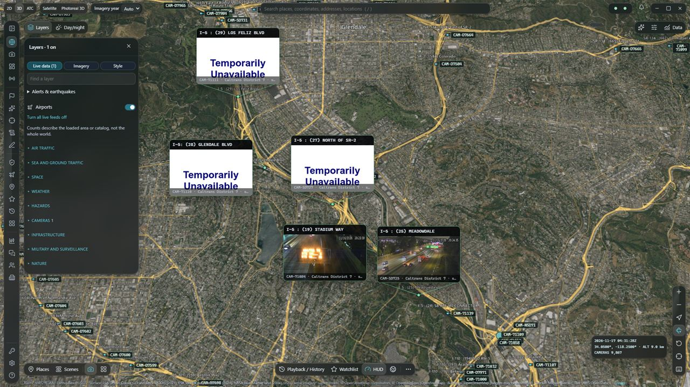 | 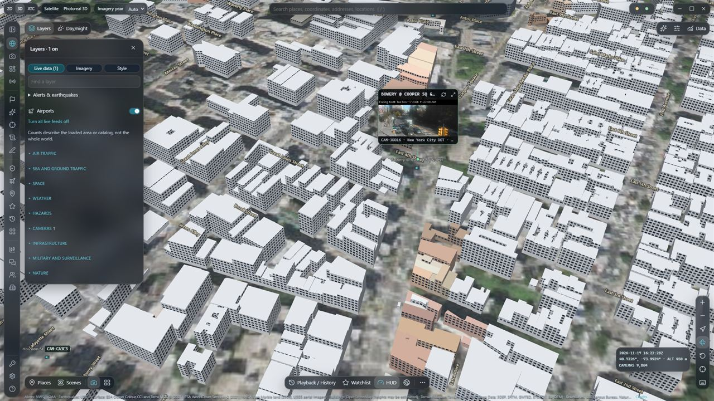 |

### Clear details for anything you click

The right panel leads with what you selected: an icon for its kind, the title, key facts in bold (time, position,
altitude, speed, heading), then the details and the source.

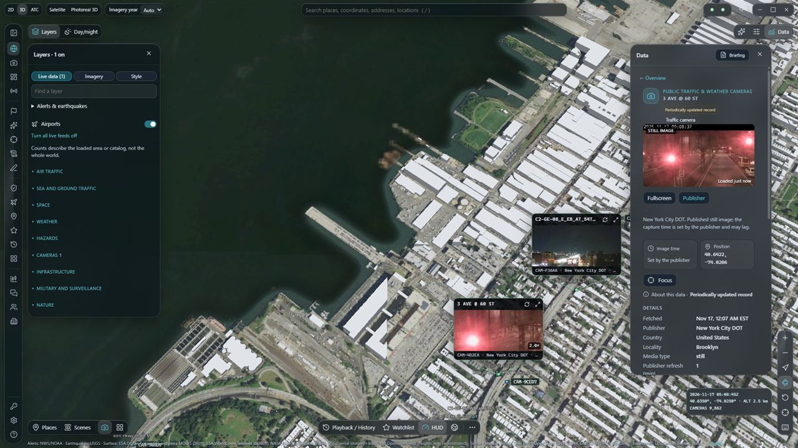

### Road traffic

**Traffic flow** shows measured speeds on roads in New York, Paris, Finland, Hong Kong and Madrid. Switch on the
simulated vehicles to see moving dots coloured by congestion, with `SIM-` tags (they are a simulation, not tracked
cars). With your own TomTom key, **Live congestion** colours roads worldwide.

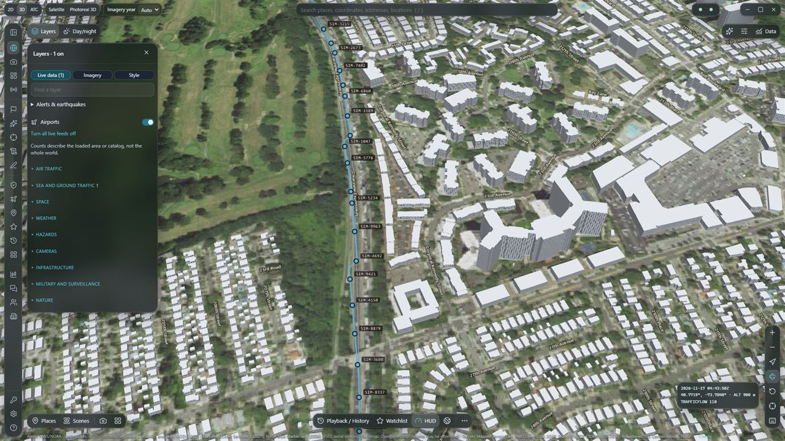

### Aircraft, ships, satellites and launches

Live aircraft (ADS-B), military-flagged aircraft, ships (AIS), satellites with predicted orbits and passes, and
space launches with an event replay. Click a plane for its type, 3D model, usual route and the nearest airports'
tower frequencies. Ships and aircraft can be followed and recorded for playback.

### Weather, hazards and the ground

Weather radar, lightning, an animated wind forecast, weather-satellite frames with a **four-hour history timeline**,
U.S. weather alerts, earthquakes (off by default), fires, wildfire perimeters, cyclones, disaster reports, and
**landslide estimates** from USGS after significant earthquakes.

| Weather timeline and wind colours | Landslide estimates |
|---|---|
| 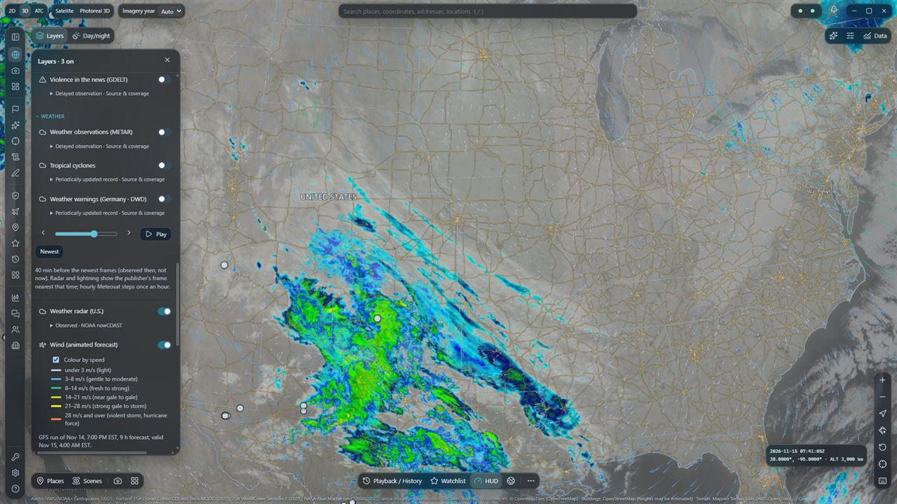 | 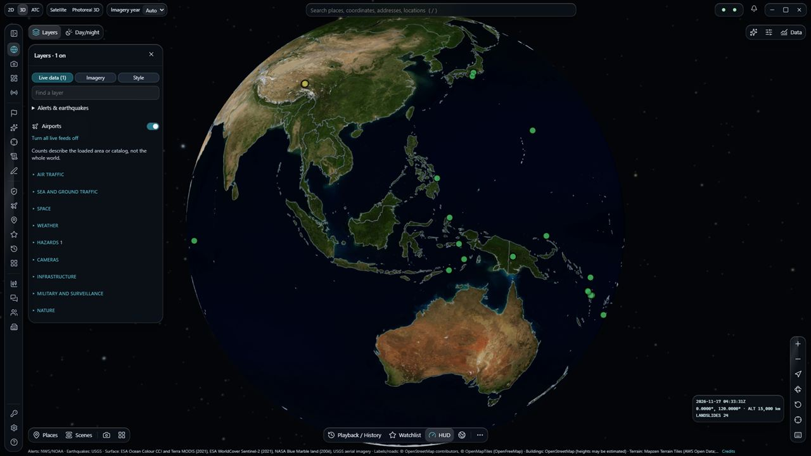 |

### Infrastructure and rivers

Internet and telecom cables (under water and under ground, as mapped in OpenStreetMap), data centres, dams,
military sites and plate-reader camera locations from OpenStreetMap, and a **Rivers and canals** overlay.

| Mapped internet cables | Rivers over Paris |
|---|---|
| 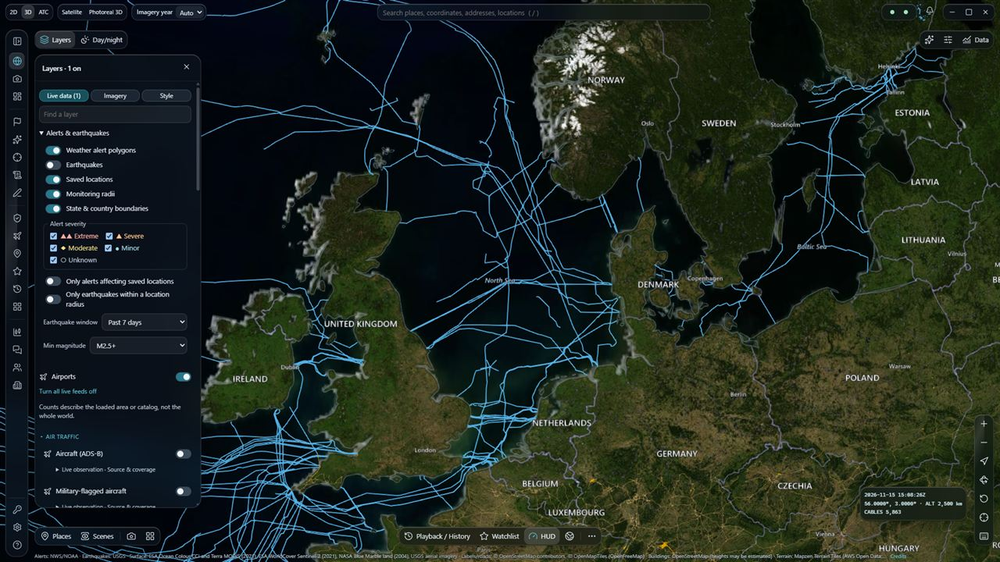 | 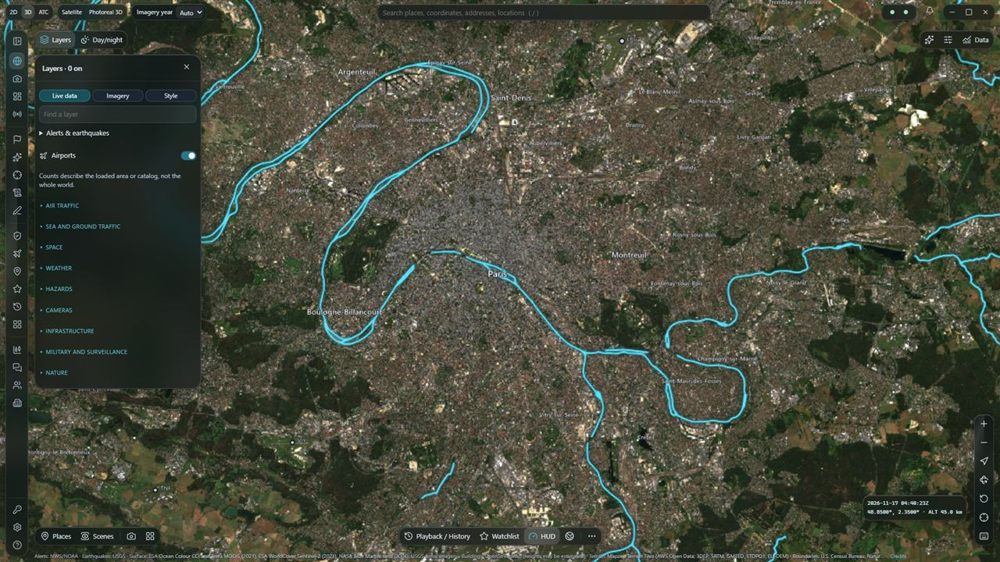 |

### Worldwide radio

The **Radio** page searches thousands of stations worldwide by name, kind, country or distance from the map centre,
and plays them inside the app. Playback continues while you use the globe. Scanner and air-traffic entries are
third-party relays and are labelled; listening to police radio is illegal in some countries.

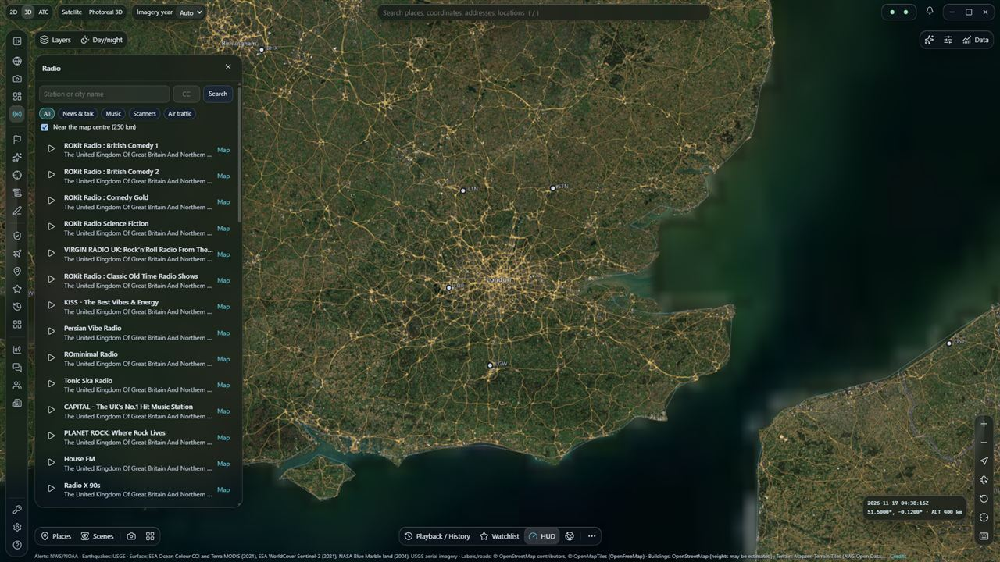

### Sharper surfaces with your own keys

Optional: Google Photorealistic 3D cities, Google satellite, Esri, Mapbox, or **Bing aerial and Cesium World Terrain**
through your Cesium ion token. The free surfaces stay available.

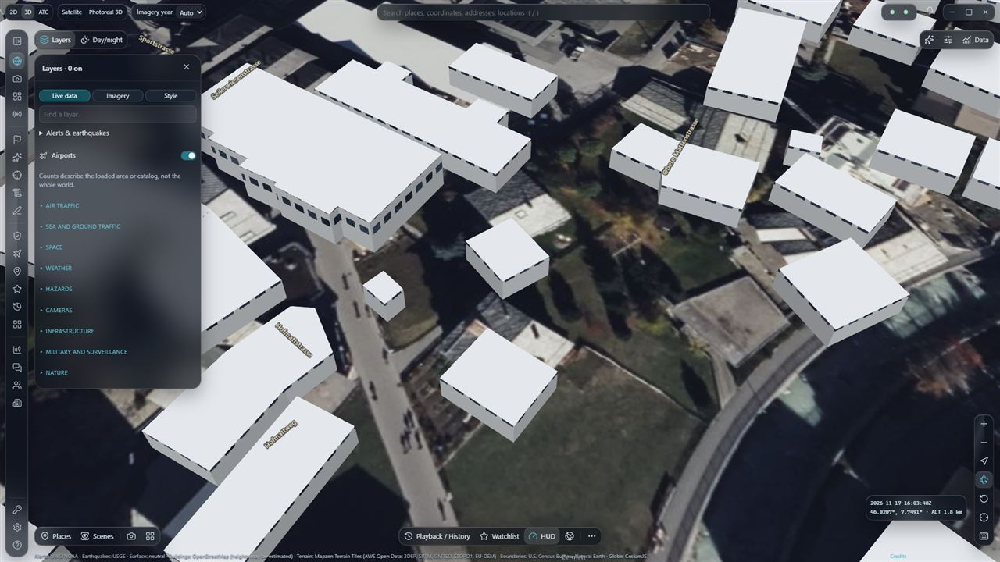

### Protective planning

The **Plan** page models lines of sight from a site over terrain and mapped buildings, finds rooftops that can see
it, compares walking and driving routes, and exports a briefing. Results are geometric estimates, not proof of
safety.

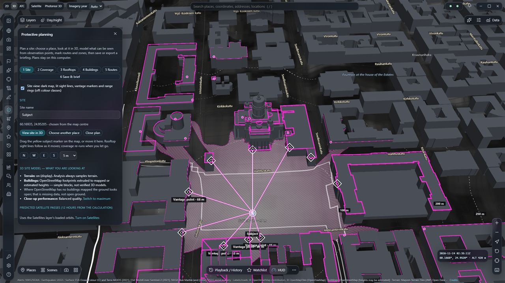

### Storm tracks and forecast cones worldwide

**Tropical cyclones** now shows every active storm in every basin (GDACS, which republishes the regional centres'
advisories), with the past track (solid), the forecast track (dashed), forecast positions with their UTC times and
the forecast cone. NHC advisories still cover the Atlantic and eastern Pacific. Cones and forecast positions are
predictions; the cone is where the centre is likely to go, and impacts reach well beyond it. Radar, lightning density
and weather-satellite clouds can be scrubbed back **four hours** in 10-minute steps.

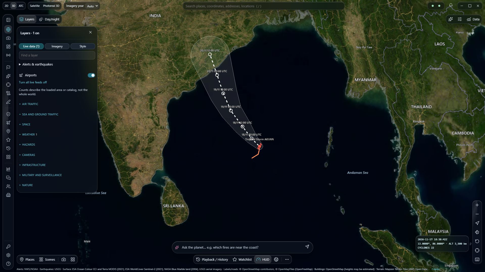

### Recent satellite images for a box you draw

In **Map tools**, choose **Recent satellite image…** and drag a box (up to 55 km across), for example around a fire,
or use **Around selection** on a selected record. Sky_View lists the Sentinel-2 passes from the last 45 days with
their cloud cover and drapes the one you pick over the 3D terrain at up to 10 m per pixel. Keyless: scenes come from
Earth Search and the AWS Open Data copy of Sentinel-2, and only the parts of the file under the box are downloaded.

### Director mode

**Map tools → Director mode** has pins, notes, lines, outlines, and freehand **Sketch path** and **Sketch outline**
(press and drag; the map holds still while you draw), with six colours. Every drawing can carry a note. Drawings are
saved locally, can be exported as GeoJSON or shared in scene files, and each one says who made it: you, an AI agent
or an Ask answer.

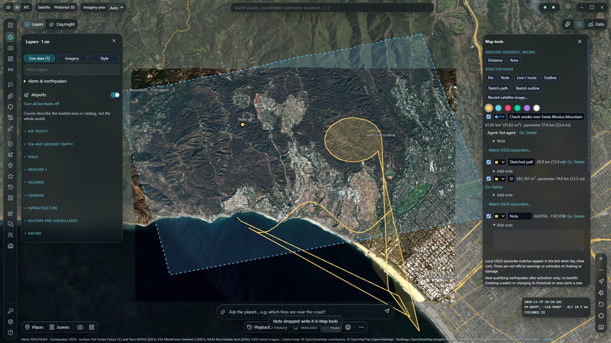

### Watch an area

**Watch** in the top bar flies to the Strait of Hormuz, Bab-el-Mandeb, the Taiwan Strait or the Black Sea and turns on aircraft, military-flagged aircraft, ships, GPS accuracy anomalies, violence in the news (GDELT) and mapped military sites. Each layer keeps its own source and coverage: aircraft come from volunteer receivers (sparse over Iran and Yemen, and military aircraft often fly without ADS-B), ships outside the Baltic need your free AISStream key, and news reports are machine-coded, not confirmed events.

**Record an area for replay.** In the same menu, **Record in the background** keeps polling one area while Sky_View is open, even when you look elsewhere: aircraft and military aircraft (every 90 s and 2 min, waiting whenever adsb.lol asks), ships from your AISStream key, GPS accuracy cells (every 3 min) and conflict reports (every 15 min). A **REC** chip in the top bar shows what each feed last recorded and stops it. **Playback** then replays the area: aircraft and ship fixes, the GPS cells and conflict reports as they stood at each moment ("not recorded" where a poll was missed), and satellites calculated for the replay time. Recording only stores observations; nothing is extrapolated, and a day that was not recorded cannot be replayed.

**Timed events.** Any drawing in Map tools can be marked as a timed event (strike, explosion, airspace or sea closure, incident) with the time it happened and an https link to where it was reported. Replay shows it from that minute on, labelled as reported. You place every event yourself from open reporting; the app places none.

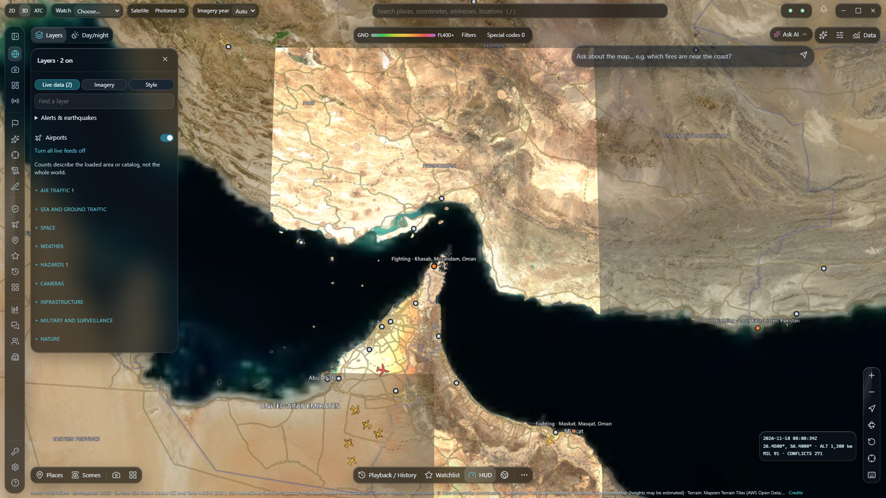

### Ask the planet

Click **Ask AI** at the top right of the globe and type a question in the box that drops down, or hold the microphone and speak it (with your OpenAI key). The box stays closed until you open it; Escape closes it.
The answer is written from the records around your view (the layers you have on, plus earthquakes), and the records
it refers to are ringed on the globe at their own positions; the AI never places anything itself. Answers can be
wrong, and each one says how many records it saw and which engine wrote it. It uses your local Ollama model when the
local AI is on in Settings, otherwise your OpenAI key (one request per question, billed to you).

### AI agents (MCP)

Turn on **Settings → AI agents (MCP)** and paste the configuration it shows into your MCP client (Claude Desktop,
Claude Code and others). Agents can then read the view, the layers that are on and their records, and add findings
to the shared canvas, where they appear labelled with the agent's name. They cannot change settings, keys, saved
places or your own drawings. The bridge is a Windows named pipe with a random token: nothing listens on the network
and no firewall rule is added. It is off by default and closes when you turn it off.

### Satellites by kind, and your own receiver

**Satellites** has 25 groups in five sections (stations and bright; navigation: GPS, GLONASS, Galileo, BeiDou, SBAS;
communications: Starlink, OneWeb, Kuiper, Qianfan, Iridium, geostationary, amateur; Earth observation; science and
other), each coloured by section. With your own ADS-B receiver (readsb or dump1090 on an SDR, set up in Providers),
the Aircraft layer shows how many aircraft your receiver hears and can draw its coverage: the farthest position heard
in each of 36 directions.

### And more

Saved places with alert and earthquake matching, CSV import, briefings (HTML/PDF), event history and replay, scenes,
day/night lighting, an imagery-year archive, markets, a community reader, voice commands (with your OpenAI key), a
render-resolution setting, tilt and "global picture" views, and visual styles.

---

## Optional keys

Everything above works without keys except where noted. Add keys in **Providers** (the key icon at the bottom of
the left rail). Keys are encrypted with Windows' credential store and never leave your computer except to their own
service. Paid services bill your own account.

| Service | Adds | Cost |
|---|---|---|
| Google Maps Platform | Photorealistic 3D cities, Google satellite | Metered (your Google Cloud billing) |
| Cesium ion | Bing aerial surface, Cesium World Terrain | Free Community plan (non-commercial), paid plans |
| TomTom | Live road congestion worldwide | Free tier, then metered |
| OpenAI | Voice commands | Metered per minute of audio |
| AISStream | Ships worldwide in your view | Free beta |
| OpenSky | More frequent worldwide aircraft snapshots | Free (non-commercial) |
| Launch Library 2 | More launch requests per hour | Paid supporter plan |
| AeroDataBox, Esri, Mapbox, market data, camera systems | See Providers for each | Varies |

---

## Feature notes

Sky_View is a Windows desktop geospatial monitoring app. It started as a tool for small businesses and property
managers who look after several locations. It shows active U.S. National Weather Service alerts and recent USGS
earthquakes, and reports which saved locations fall inside an alert or near an epicenter. On a detailed 3D globe it
also shows live public data layers: aircraft, vessels, satellites, fires, airspace, radar, weather observations,
cyclones, cameras, and transit. Details show source links and observation times when supplied. Briefings can be exported.

Double-click [start.bat](start.bat) to open the newest packaged copy in this project.
Atlas opens with offline satellite imagery and terrain. Where detailed coastal imagery ends, the water shows observed ocean colour from ESA and NASA. The land layer leaves ocean and mapped lake pixels visible. Atlas uses finer Sentinel-2 or U.S. aerial imagery where available. With **Photoreal 3D** selected, coastal views switch to photographic imagery to show the water. [Water and sky verification](docs/PROGRESS.md#satellite-water-imagery-years-and-night-viewing).

Use **Imagery year** in the top bar to select a satellite archive year. Most years show a NASA observation near July 1, with other observations from the same year filling missing orbital swaths. Clouds and seasonal differences can be visible between observations. The map shows source dates. **Auto** returns to your usual basemap.

Open **Day/night** beside **Layers**, then select **Current sunlight** to see the dark hemisphere and its city lights. **Choose time** lets you move the sunlight with a UTC date and time slider. **Daylight** restores even illumination. The lights come from NASA’s 2016 Black Marble composite. The offline star background uses 9,096 measured star positions from the Yale Bright Star Catalog.

**Markets** opens with the ten most actively traded U.S. stocks by reported share volume. Select a stock to read publisher previews and then open an article. The saved watchlist and charts are in **Watchlist**. [Markets verification](docs/PROGRESS.md#trending-markets-and-article-previews).

In **Layers → Live data**,
turn on **Aircraft (ADS-B)** and click a plane. Its card shows the aircraft identity, available build year and
type specifications. Drag the 3D preview or use its arrow buttons to rotate it. **View route on map** fits the
published airport route to the globe. Choose **Follow** under a passenger flight’s heading to keep the plane
centered as it moves. With **Smooth aircraft motion** on in Display settings, the plane moves between reports
using its last reported speed and ground track. The estimate pauses after 45 seconds without a new report.
For dated status, add your own **AeroDataBox** direct API key in
**Providers**, then choose **Check dated flight status** on a passenger flight. That action uses your plan.
The usual airline routes and bundled models work without a key. [Coverage, sources and screenshots](docs/PROGRESS.md#aircraft-selection).

Select a plane, helicopter or ship on the globe to rotate its model. The app includes credited Sketchfab models for
45 aircraft types and nine vessel categories, including cargo ships and tankers. Other types use a labeled
representative shape based on the available aircraft designator, broadcast category or AIS ship type.
When a feed omits the type, the card identifies the shape as generic. [Model coverage](docs/PROGRESS.md#vehicle-model-coverage).

Open **Events → Conflict updates** for dated humanitarian reports by country or territory. Choose
**CFR assessments** to see the Council on Foreign Relations’ assessments by region and open an individual
situation’s overview. Where recent reports cover the same country, the assessment links to those reports.
Each feed shows its last successful check. [Conflict sources and coverage](docs/PROGRESS.md#conflict-updates).

For Germany, open **Layers → Live Data → Weather → Weather warnings (Germany · DWD)**.
Open a German bulletin from **Events → DWD warnings (Germany)** or select its published polygon on the globe.
Warnings with only a named area are available in Events and Official bulletins. Selecting one opens its original
German text and validity times. A saved place's details show any intersections with the published horizontal polygons.
Historical Replay and exported location briefings cover their existing NWS/USGS datasets.
The packaged app matched a live DWD snapshot of 21 bulletins, including five with named areas only, and revalidated it with DWD after restart. [Verification and screenshots](docs/PROGRESS.md#german-weather-warnings).

Use the top search box to find a place offline by its published name or a local spelling. Try `東京`,
`Sao Paulo` or `London, Ontario, Canada`. All three use the bundled Natural Earth catalog. Decimal
coordinate pairs and WGS84 `geo:` links go straight to the map. [Search verification](docs/PROGRESS.md#worldwide-place-search).

For U.S. fire boundaries, open **Layers → Live Data → Hazards → Wildfire perimeters**. Select any filled part
of a published perimeter to see its incident, capture and edit times. The details distinguish mapped acreage
from reported incident size. Discover ranks loaded perimeters with published mapped acreage. NIFC includes
wildfires and prescribed fires where a perimeter is available. [Verification and screenshots](docs/PROGRESS.md#us-fire-perimeters).

Before adding a feature, find its status in the [requirements audit](docs/REQUIREMENTS_AUDIT.md), then check its
source, tests and normal entry point in the running app. The [progress record](docs/PROGRESS.md) links to
screenshots and verification logs. The [feature comparison](docs/FEATURE_MATRIX.md) opens with current updates.
Its historical tables predate features documented in the [v0.5–v0.7 implementation notes](docs/FEATURES-v0.4.md).
The [reference review](docs/REFERENCE_RESEARCH-2026-11-11.md) identifies the exact upstream revisions inspected.

It runs entirely on the user's computer. **Core features need no accounts, API keys, paid map service, or paid
data service, and no server.** Optional integrations (AISStream, Google Photorealistic 3D, a local ADS-B
receiver, Ollama) stay off until the customer configures them with their own account.

> Sky_View is a public-data monitoring tool. It is **not** an official warning service, a live satellite
> feed, or a people-tracking tool. Data may be delayed, revised, or incomplete. In an emergency, follow official
> NWS and local alerts.

---

## Features

| Area | What it does |
|---|---|
| Globe and map detail | CesiumJS globe with **progressive tile detail**. The NASA Blue Marble land reference reaches zoom 8 (about 500 m per pixel). The global water image comes from ESA Ocean Colour CCI and NASA Terra/MODIS observations. The ESA WorldCover 2021 Sentinel-2 composite adds 10 m imagery where available over land and coastal waters. **USGS National Map orthoimagery** covers the lower 48, Alaska, Hawaii, and Puerto Rico to zoom 16 (about 2.4 m per pixel, neighborhood detail). Other surfaces: NASA VIIRS daily satellite imagery (previous UTC day, dated), USGS imagery with labels, USGS topo, bundled offline relief, and neutral. **3D terrain** comes from the keyless Terrain Tiles on AWS. A **diagnostics panel** (`Diag`, Ctrl+Shift+D) shows providers, tile levels, pending and failed requests, and when a provider's maximum detail is reached. The globe has U.S. / Lower 48 / Alaska / Hawaii views, north-up, reset, and keyboard navigation. |
| Data layers | Aircraft (adsb.lol, ODbL; filters for fighter and attack jets by reported type code, and all military), military-flagged aircraft, vessels (Fintraffic AIS keyless; AISStream with your key; one-click tanker filter for AIS ship types 80–89), satellites (CelesTrak elements, positions **calculated** by SGP4), NASA FIRMS fire detections, NIFC wildfire perimeters, FAA prohibited/restricted airspace, NOAA nowCOAST radar and lightning density, animated NOAA GFS wind forecast, GPS accuracy anomalies from aircraft reports, space launches (Launch Library 2), live trains from selected operators, bike-share stations, wildlife sightings (openly licensed iNaturalist records), Canadian air quality (AQHI), violence reported in the news (GDELT, machine-coded), street-level photos (KartaView, Panoramax), data centres and a sample of dams (bundled OpenStreetMap data), traffic flow for New York, Finland, Hong Kong, Madrid and Paris (measured per road or sensor, never individual vehicles; optional simulated moving dots on the New York and Paris roads, labelled as simulated), air traffic control radio for a selected aircraft (nearest airports' published frequencies and a link to the airport's LiveATC.net page; the app does not stream audio), METAR observations, NHC cyclones, Caltrans and Fintraffic cameras, and live buses, trams and ferries from MBTA and 36 other operators' GTFS-Realtime feeds (real vehicles, one dot each). Each layer is labeled live / delayed / periodic / calculated / static and shows freshness, record count, fetch time, coverage notes, and errors. Layers poll only while switched on. |
| Tools | Search (coordinates, `geo:` URIs, 7,342 bundled places, U.S. Census address lookup), click-to-track with recorded trail, nearby contacts (250 km), predicted satellite orbit, geodesic distance and area measurement, pins / routes / areas annotations, saved views, last-view restore, scene file export/import (no credentials), playback of recorded movement, a HUD, and display styles (night vision / thermal-style / CRT / noir, all labeled as visual effects only). |
| Later map and tracking additions | Screen-space place and road labels with collision handling, local scripts and independent vehicle label controls; type/category-specific aircraft and vessel symbols, app-built 3D vehicles and optional attributed model packs; watchlists, airports and overhead search. Follow works across batched/entity rendering; fresh airborne observations support a simulated cockpit perspective aligned to reported track/heading, with fixed pitch/roll and stale-data exit. Optional identification photos and reported-route lookup distinguish a usual callsign route from an observed track or today's flight plan. |
| Camera workspace | Existing HLS player, refreshed stills and official viewer links; search, country/region and media filters, favorites and map navigation. Existing local boards now group up to 32 camera references, four cards per page and at most two video streams; background players disconnect while a board is open, and hidden/paused players release media. Open-data adapters include Caltrans, NYC DOT, Fintraffic, TfL, Hong Kong, DriveBC and Québec; 22 optional systems require customer credentials and their publisher's terms. A listed camera is not a guarantee of availability. |
| Dated imagery and weather satellite | 23 NASA GIBS products with source-checked dates, gap-aware playback/navigation, two-date swipe comparison and per-date raster-request health; a listed date may still have missing raster tiles. Separate GOES/Himawari weather satellite frames retain their own coverage and acquisition times. Normal, CRT, NVG, FLIR, Anime, Noir and Snow styles are visual effects. |
| Protective planning | The **Plan** page: choose a site (globe click, map centre after a search, or a saved location), view it in 3D, and model lines of sight from the site itself (no extra point needed) and any added observation points and cameras over terrain and OpenStreetMap building heights. Results are a labelled geometric estimate (clear in mapped data / blocked / unknown), never proof of safety or threat; ground without mapped buildings is modelled as open only after you choose that, and missing data stays unknown. Also: mapped rooftops with a modelled clear line of sight to the subject (outlined at roof height, updated live while you drag the subject marker), up to three walking or driving route options between two points computed on this computer from the map tiles' road network (length, time estimate, major-road share, junctions, share overlooked by mapped rooftops and watched by your points; measures, not a safety rating; both saved with the plan and listed in the briefing), OpenStreetMap building details and nearby emergency facilities, your own floor-plan images aligned to the map, roles for drawn routes and zones with a route comparison, locally saved plans, and an HTML/PDF briefing with a site diagram. Not provided: property ownership, interiors, turn restrictions or live traffic in routing, crowd simulation, video projection, shared plans. [Details and evidence](docs/PROGRESS.md#protective-planning-workspace--2026-11-12) |
| Satellite passes | Select a satellite, enter worldwide observer coordinates/elevation or choose an existing saved place, then calculate the next 24 hours of rise/peak/set events. Uses loaded orbital elements locally in a bounded worker; stale-element warnings, UTC/local times and no-pass/unavailable states are explicit. Geometric passes do not establish optical visibility. |
| GeoJSON annotations | Tools → Import GeoJSON previews local points, lines and simple exterior polygons, reports rejected/duplicate features, and requires acknowledgement before importing valid features only. Atomic import adds new annotation IDs; export shares geometry/name/color/visibility without saved places, notes or credentials. The supported subset and limits are described below. |
| External Street View | Tools → Street View in Google Maps sends the current screen-center coordinates to the default browser on click. This is a partial street-level workflow: Google chooses an available historical panorama; Sky_View does not embed, capture or verify imagery availability. See [source/terms and verification limits](docs/STREET_VIEW.md). |
| Existing workspaces | Incident register, trends, country summaries and source monitor; local boards and team directory; optional Markets adapters and Lemmy Community. Market-data plans and redistribution rights must be checked separately; credentialed and authenticated workflows have separate verification limits. |
| Provider settings | Shows source coverage, terms, setup instructions and available connection or configuration checks. Customer-entered credentials are encrypted in local storage using Electron `safeStorage` (Windows DPAPI). Google, Esri and Mapbox client keys are available to the map renderer for the enabled service. |
| Weather alerts | Pulls active alerts from `api.weather.gov` with severity, urgency, certainty, event, headline, description, instructions, onset, ends, expires, sender, area, zones, and identifier. Polygons are drawn when supplied. Zone-based alerts without a polygon are listed and still evaluated, never drawn as a made-up shape. |
| Earthquakes | Pulls USGS GeoJSON summary feeds with a configurable window (hour/day/week/month) and minimum magnitude. Markers encode magnitude by size, color, and an `M5.2` label. Details show magnitude, depth, time, epicenter, review status, and the USGS event page. |
| Earthquake area watches | Set a magnitude threshold on an existing drawn or imported area in Map tools. New qualifying USGS epicenters create local matches in the existing bell. Each match retains its source ID, reported origin time, coordinates, magnitude and local detection time. Opening a match marks it read. |
| Saved locations | Add by typing latitude and longitude or by clicking the globe. Each has a name, category, notes, and monitoring radius, and can be edited or deleted. Locations are stored in SQLite. CSV import has column mapping, a preview, validation errors, and duplicate handling. CSV export is included. |
| Monitoring | Saved places use supplied alert polygons, typed NWS zone IDs and geodesic distance to earthquake epicenters. A complete reply supports an exact count. Partial replies show confirmed matches with their limits. Offline or failed refreshes show the last observation and its time, with the current total marked unknown. Open **Data → Briefing** for the same evidence in HTML or PDF. |
| Event history and replay | Search local alert and earthquake history, then choose **Replay at last observation**. The existing timeline shows recorded NWS alert polygons, USGS epicenters and movement fixes at one cursor. Open **Data** for the recorded details, including zone alerts without polygons. |
| Saved investigations | In **Scenes**, name and save the current view. Restore its camera, 2D/3D mode, display filters, imagery configuration and selected alert or earthquake. A recorded view opens at its saved UTC time. A live view uses the current provider data. |
| Briefing | Preview and export a location report or a **Since last visit** report as HTML or PDF. Location reports cover your selected places. Visit reports compare recorded NWS and USGS replies across two app launches, with source IDs, links, observation times and any gaps in coverage. |
| Optional local AI | If you run **Ollama** yourself, Sky_View can ask a local model to explain results it has already calculated. It connects only to loopback (127.0.0.1) and never downloads models. Answers are labeled as AI-generated. The app is fully usable without it. |
| Reliability | Last-known data retains original timestamps. Main-process HTTP shares publisher pauses across callers, preserves long Retry-After waits and delayed redirects, and schedules long deadlines through bounded timer hops. Polling, timeouts, backoff and stale/unavailable states remain provider-aware. These paths have regression coverage; outages and live quotas still depend on each source. |

---

## Quick start (development)

The development build was tested on Windows x64 with Node.js 24.22.1 and npm 11.19.1.
For Node 22, the locked Cesium packages require at least 22.17.0.

```bash
npm ci
```

The checked-in `package.json` already approves the install scripts for the locked esbuild and electron-winstaller versions.

Electron downloads its binary on first launch. To download it ahead of time:

```bash
node node_modules/electron/install.js
```

Run in development mode (Vite dev server + Electron, with hot reload for the UI):

```bash
npm run dev
```

Build and run the production bundle without packaging:

```bash
npm run build
```

```bash
npm start
```

## Checks

```bash
npm run typecheck
```

```bash
npm test
```

```bash
npm run smoke
```

`npm run smoke` launches the built app with a temporary database. It waits for live feeds, prints the
renderer and feed status, and saves a screenshot. It needs network access.

The November 11 monitoring build passed typecheck, **795 tests across 51 suites**, and the production build.
The [monitoring verification record](docs/PROGRESS.md#saved-location-monitoring-evidence) covers saved places and source outages.
The [visit briefing check](docs/PROGRESS.md#since-last-visit-briefings) includes the [two-visit screenshot](docs/screenshots/visit/audit-visit-second-ready.png).
The earlier desktop Scenes check saved a real NWS alert and a USGS earthquake, reopened them after an offline
restart, and checked what the user sees when the local observations are missing. Its results and before/after
screenshots are in the [Scenes verification record](docs/PROGRESS.md#saved-investigations-in-scenes).

In the earlier desktop replay check, all 414 recorded NWS alert identifiers and issue times, and all 199 USGS
earthquake identifiers, magnitudes, coordinates and update times matched the actual provider responses.
Earlier-revision and gap checks used controlled historical fixtures. [Timeline check and screenshots](docs/PROGRESS.md#shared-historical-timeline).
Desktop checks used real USGS observations for earthquake area watches. The NOAA adapter returned stations
from both sides of the date line. An isolated upgrade-copy check preserved the prior release's SQLite records.
Earlier GeoJSON and Street View checks used temporary native-dialog and shell adapters. Native file-picker input,
default-browser behavior, and installer installation/upgrade remain open. See the [progress record](docs/PROGRESS.md).

## Packaging a Windows installer

```bash
npm run dist
```

This runs type checking, builds, regenerates `THIRD_PARTY_NOTICES.md`, and writes
`release/Sky_View-Setup-<version>.exe`, a per-user NSIS installer. For an unpacked folder you can run
directly, use `npm run dist:dir` (the output is `release/win-unpacked/Sky_View.exe`).

To reproduce the handoff installer with customer-supplied credentials, open a fresh PowerShell session in the
project and point the existing build setting at an empty JSON object. The build should print
`Built-in credential providers: none`.

```powershell
$customerKeyConfig = New-TemporaryFile
Set-Content -LiteralPath $customerKeyConfig.FullName -Value '{}' -Encoding ascii
$env:ATLAS_WATCH_BUILTIN_KEYS = $customerKeyConfig.FullName
npm.cmd run dist
```

The installer is **not code-signed**, so Windows SmartScreen will warn on first run. Signing with a
code-signing certificate is a later step. Configure `win.certificateFile` or Azure Trusted Signing in
`electron-builder.yml`.

End users need nothing else installed: no Node, Python, Docker, or terminal.

The current flight-card installer is [release/flight-card/Atlas-Watch-Setup-0.7.0.exe](release/flight-card/Atlas-Watch-Setup-0.7.0.exe).
It is unsigned and its SHA-256 is `932D440E35C1290D5E149D872F7A39131EF7A318C62B9A5F5E2957A95D880203`.
This side-by-side release lets an earlier Sky_View session finish normally. Close the older window and double-click
[start.bat](start.bat) to open the newer package. [Flight-card installer audit](docs/flight-card-package.log).

The preceding November 11 worldwide place-search installer, `release/Atlas-Watch-Setup-0.7.0.exe`, is **128,122,660 bytes**, unsigned.
Its SHA-256 is `FD97F4112DF00A5206AB5A283018B5323EC8366BCBE88DA6B3183622BFD3B948`.
The installer contains the same ASAR archive as the unpacked application. All 351 production files, the notices
and both sample files matched their build inputs. The packaged app completed 19 offline map selections and
opened a live U.S. Census address match. [Package audit](docs/place-search-package.log) · [Desktop search checks](docs/PROGRESS.md#worldwide-place-search).
The preceding saved-location build matched 541 NWS alerts and 209 USGS earthquakes to the live replies on each of two launches.
Saved-place matches opened the original source details, survived the restart and appeared in exported reports.
Windows installation and installer-driven upgrade remain untested. [Packaged window check](docs/location-evidence-packaged.log) and [location screenshot](docs/screenshots/location-evidence/audit-location-packaged-live-summary.png).

---

## Running it (Windows PowerShell)

If PowerShell reports that running scripts is disabled, use `npm.cmd` instead of `npm` (or use Command Prompt):

```powershell
cd Sky_View
npm.cmd run dev
```

## Using it

1. **Add locations.** Use **+ Add** (type coordinates or click **Pick point on globe**), or **Import CSV**. See
   [`samples/sample-locations.csv`](samples/sample-locations.csv) and [`samples/README.md`](samples/README.md)
   for the format.
2. **Review.** The list shows each location's confirmed alert count with its top severity, plus `?` for alerts
   that could not be determined and `◎` for earthquakes within the radius. Select a location for details.
3. **Check sources.** Select any alert or earthquake to see the full record and open the NWS or USGS source.
4. **Filter.** Use alert severity, "only alerts affecting saved locations", the earthquake window and minimum
   magnitude, and "only earthquakes within a location radius".
5. **Briefings.** Open **Data → Briefing**. Choose **Location briefing** for your saved places, or **Since last visit** to compare the previous app run with this one. The visit report works without saved places. It lists newly returned, updated and no-longer-returned source IDs. A changed query, an incomplete reply, or a missing observation can prevent comparison. Export the reviewed report as HTML or PDF. For a location report larger than 8 MiB, the dialog offers **Export current HTML** and **Export current PDF**, which regenerate the full report at export time.
6. **History.** Open **Event history** to search records, or choose **Replays → Open playback timeline**. Each feed shows its recording time and query scope. A successful empty reply, an incomplete reply, a gap and a time before the first retained observation have distinct labels. Older databases keep their event summaries and movement tracks. Recording of full alert and earthquake replies starts with the first successful refresh on this version.
7. **Data layers.** Switch layers on in the left panel. Hover a layer for its source, terms, coverage, and
   data type. Aircraft and METAR load for the current view, so zoom in. Click any marker for details, **Track**,
   nearby contacts, the camera still, or a satellite's predicted orbit.
8. **Tools and Scenes.** Use **Tools** for measuring, drawing and display styles. Use **Scenes** to save a
   named view or import/export a scene file. You can open Scenes beside the Data panel during Replay.
   Use **Diag** for map diagnostics.
9. **Providers.** Use the **Providers** button for connection tests and optional credentials.

**GeoJSON in Tools.** Choose **Import GeoJSON…**, review names/geometry and every rejection/duplicate, then
acknowledge any skips before importing valid features. Cancel saves nothing. Existing annotations are not
overwritten, and repeated geometry/name matches are skipped against both stored and same-file annotations.
**Export annotations…** writes the same annotation collection through the save dialog.

Supported geometry is 2D WGS84 `[longitude, latitude]` Point, LineString and a simple Polygon with one closed
exterior ring. Holes, Multi geometries, GeometryCollection, altitude, CRS declarations, degenerate/self-crossing
and globe-wrapping rings are rejected. Limits: 2 MiB UTF-8, 2,000 features/stored annotations, 5,000 positions
per geometry including polygon closure and 20,000 positions per file, with bounded intersection checks.
Only name, color and visibility are retained from properties; source IDs and foreign fields are discarded.
Lines and polygon edges use the globe's shortest geodesic paths, which can differ from GeoJSON's straight
longitude/latitude segments; add vertices for the intended shape. Imported areas can be used for a watch after you save them.

**Watch an area for earthquakes.** In **Map tools**, expand **Watch USGS epicenters…** beneath a saved area.
Choose the minimum magnitude and select **Add watch**. The area can stay hidden on the map. Matching includes
the boundary and follows straight longitude/latitude segments across the shorter date-line crossing. Widely spaced
vertices can produce a different boundary from the arcs drawn on the globe. Pole-touching and self-intersecting
areas cannot be watched.

An enabled watch checks the configured USGS feed on successful refreshes while Sky_View runs. It accepts
earthquakes with known magnitude and an origin time after the watch was armed. Re-enabling a watch or changing
its geometry or threshold starts a new period. The editor shows the source's actual window and minimum magnitude,
the last local check, and any limits on evaluation. A smaller rule threshold cannot recover observations absent
from the selected feed. The watch uses the existing keyless connection and polling schedule.

The app skips cached responses and waits if the USGS generation timestamp is missing, more than 15 minutes old,
or more than two minutes ahead of the local clock. Up to 100 rules can share 20,000 enabled vertices. The bell
retains the newest 500 matches across all areas. If a processing limit prevents a full check, Map tools shows
the incomplete status and keeps the time of the last complete check.

Open **Notifications → Saved area matches** to inspect the recorded evidence or focus the map on the reported
epicenter. A publisher revision or app restart does not by itself create another notification for the same event.
Reading a match preserves the evidence. Pausing preserves the rule and its matches. Removing a watch or deleting
its area removes that watch's local matches. USGS event history follows its own retention settings.

**Street View in Tools.** Move the globe to the location, then click **Street View in Google Maps ↗**. The action
uses the center of the screen at click time and refuses a missing globe intersection or a view morph. The
external Google viewer handles imagery/attribution; the link requires no Sky_View API key or billing setup.
Availability, capture dates and actual default-browser handoff are not established by the fixture tests.

Data is stored in `%APPDATA%\Atlas Watch\atlas-watch.sqlite` (locations, settings, feed cache, history).

### Settings

* **NWS contact (optional):** a website or email added to the User-Agent sent to `api.weather.gov`, as NWS
  requests. Leave it blank to send a generic app identifier.
* **Refresh intervals:** NWS defaults to 180 s and USGS to 300 s, with a 60 s minimum.
* **NWS zone lookup:** on by default. Each location's coordinates are sent to `api.weather.gov/points` about
  once every 30 days to learn its zones. Turning it off makes alerts without a polygon show as "cannot determine".
* **History retention:** 30 days / 5,000 records by default.
* **Globe surface** and **reduce motion**.
* **Local AI:** enable, set the port (host is always 127.0.0.1), choose an installed model.

---

## Architecture

```
src/
  shared/      Pure, tested logic used by both processes
    types.ts       Domain types (UTC ISO timestamps everywhere)
    normalize.ts   Validates and normalizes NWS/USGS payloads; malformed records are counted and skipped
    geo.ts         Geodesic distance (geographiclib, WGS84), point-in-polygon (Turf), antimeridian handling
    monitoring.ts  Location × alert/quake evaluation, freshness rules
    dedupe.ts      Superseded-alert detection, cross-network quake merge, refresh diffs
    csv.ts         Parse, map, validate, de-duplicate, plan import, injection-safe export
    briefing.ts    Deterministic HTML briefing (no scripts, no remote resources)
    ai.ts          Grounded prompt builder (computed results + untrusted-data framing)
    ipc.ts         IPC channel names and zod schemas for every request
  main/        Electron main process (owns network, disk, and timers)
    main.ts        Window, menu, IPC wiring, PDF export
    security.ts    app:// protocol, CSP, renderer request allow-list, navigation/permission lockdown
    core.ts        AppCore: polling, backoff, rate-limit cool-down, cache, evaluation, zone lookup queue
    store.ts       SQLite persistence via Node's built-in node:sqlite (no native add-ons)
    handlers.ts    Validated IPC handlers (no Electron imports, so they are testable)
    feeds/http.ts  Allow-listed fetch with timeout, manual redirect checks, and size cap
    feeds/sources.ts  NWS and USGS adapters behind AlertSource / QuakeSource interfaces
    ollama.ts      Optional loopback-only Ollama client
  preload/     Narrow contextBridge API (no generic invoke)
  renderer/    React + TypeScript UI, CesiumJS globe
tests/         Vitest suites with separate fixtures in tests/fixtures/
```

**Data flow.** The main process fetches feeds from fixed URLs, normalizes them, stores a cache plus history in
SQLite, evaluates every saved location, and pushes a snapshot to the renderer. JSON feed adapters run in the main
process. The renderer loads local assets and explicitly allow-listed map tiles, camera media and identification
images. Optional imagery destinations are enabled only when configured. `src/shared/remoteHosts.ts` is the
renderer allow-list and CSP source; `src/main/feeds/http.ts` defines the core JSON-feed destinations.

**Future server-side cache.** `AlertSource` and `QuakeSource` are the seam. A cache adapter that calls your
local server instead of NWS/USGS can implement the same interfaces and be passed to `AppCore` in `main.ts`.
The UI, monitoring, and storage stay unchanged. Add the server host to `ALLOWED_HOSTS` in
`feeds/http.ts` when you do.

**Extension points kept clean for later:** licensing, billing, accounts, and auto-update would all live
in the main process behind new IPC channels. None are implemented, and nothing phones home.

### Security measures

* `contextIsolation: true`, `nodeIntegration: false`, `sandbox: true` (plus `app.enableSandbox()`), `webSecurity: true`.
* The renderer is served from a custom `app://atlas` origin with a restrictive CSP: no inline scripts and only
  explicit remote tile/media/image prefixes. `'wasm-unsafe-eval'` is allowed only because CesiumJS compiles bundled WebAssembly; JavaScript
  `eval` remains blocked.
* Every IPC request is validated against a zod schema. Requests from any frame other than the app's main
  frame are rejected.
* Main-process data adapters use validated provider destinations, including NWS, USGS and the configured layer,
  camera, market and community services. Redirects are checked; keyed cameras restrict credential delivery to
  their publisher. Ollama stays on loopback; the optional ADS-B receiver accepts literal private IP addresses.
  There is no unrestricted URL proxy.
* External links open in the system browser only for `https` URLs on an allow-list (weather.gov, noaa.gov,
  usgs.gov, and a few attribution sites).
* Remote text is length-limited, stripped of control characters, and rendered as text, never as HTML.
  Briefings escape all content and carry their own `default-src 'none'` CSP.
* CSV export neutralizes spreadsheet formula injection.
* PDF rendering happens in a hidden window with JavaScript disabled and the network blocked.
* Coordinates and notes are not written to logs.
* Permission requests are denied except HTML fullscreen for the app's own page (the camera Fullscreen control).

---

### Map detail: what was wrong and what changed

The original globe used CesiumJS's bundled **Natural Earth II** texture. Its tile pyramid stops at **level 2
(about 20 km per pixel)**, so Cesium could only stretch it as you zoomed. That is why the map looked blurry. It
was a source-resolution limit, not a rendering bug. The globe now uses real multiresolution tile pyramids:

- **Global overview:** ESA Ocean Colour CCI and NASA Terra/MODIS provide water observations. The NASA GIBS Blue Marble land reference reaches zoom 8 (about 500 m per pixel).
- **Land and coastal waters:** ESA WorldCover Sentinel-2 true colour, 2021 annual median, 10 m per pixel, zooms 8–14 between 60° S and 83° N where available. [Publisher and attribution](https://esa-worldcover.org/en/data-access).
- **United States:** USGS The National Map orthoimagery, zoom 0–16 (about 2.4 m per pixel). Levels 17 and up
  return 404 from the service, so Cesium stops there and keeps the level-16 tiles on screen.
- **Terrain:** Terrain Tiles on AWS (terrarium), real elevation to zoom 15. Deeper levels resample level 15
  rather than inventing detail.

Cesium requests only visible tiles, keeps parent tiles on screen while children load, and cancels requests
for tiles that leave the view. Tiles are cached by Chromium's HTTP cache according to each provider's headers.
The bundled optical composite supplies offshore water while finer layers load and outside their coverage.
USGS orthoimagery spans various acquisition years. NASA Blue Marble is a 2004 composite.


### Ocean and white-area defects (v0.3): root cause and fix

Isolation testing at the reported locations (Baja California, and the Gulf of California at 318 km) showed
that terrain, boundaries, weather polygons, and shaders were not involved. All of the artifacts came from the
USGS imagery layer and the global base:

- **White sheets.** Outside U.S. coverage, USGS returns *opaque white* no-data tiles instead of 404 or
  transparent tiles. Two kinds were seen: PNG tiles that are about 96% white, and uniform white JPEGs of
  about 2.4 KB. The app's U.S. rectangle included Mexico and open ocean, so these were drawn there.
- **Black wedges.** The transparent parts of those same PNG tiles let the old global layer (Blue Marble
  Next Generation, with a near-black ocean) show through.
- **Rectangular cutoffs.** These were the edges of the U.S. rectangle, where USGS low-zoom imagery (bright,
  bathymetry-shaded ocean) met the dark global layer.

**Fix:**

- `UsgsImageryProvider` makes no-data white pixels transparent: PNG tiles always, and JPEG tiles only when
  they are smaller than 4 KB and more than 99.5% white. Real imagery tiles are 20–40 KB.
- The global base is now NASA *Blue Marble Shaded Relief + Bathymetry*, whose ocean matches the USGS tiles.
- USGS is used from zoom level 9 down.

A second bug made custom-drawn tiles render upside down. Cesium expects imagery bitmaps created with
`imageOrientation: 'flipY'`, and Chromium ignores the WebGL upload flip for `ImageBitmap`. All custom
providers now create flipped bitmaps.

A third defect showed up during worldwide checks: a **black vertical stripe at 180°** (east of Fiji). This is a
source defect in NASA GIBS. The easternmost tile column (x = 2^z − 1) ends in a 2–9 pixel band of near-black
pixels, plus JPEG noise. `GibsBaseProvider` detects the band in those tiles only, by comparing column
averages, and fills it from the nearest valid column in each row. It adds no new detail. A slight brightness
step remains at 180°, because the source imagery on the two sides differs.

**Follow-up fixes (v0.3.1):**

- **Coastal imagery.** The earlier offshore fade has been retired. Valid USGS and configured satellite imagery stay visible through their coverage edges. The 10 m Sentinel-2 composite covers additional coasts.
- **Open ocean.** The current Atlas stack uses observed satellite water colour from ESA and NASA. The older bathymetry background and simulated ripples have been removed from water views.
- **Black discs over both poles.** The terrain used the Web Mercator tiling scheme, which stops at
  ±85.05°, so the globe had no surface over the poles. Terrain is now resampled into Cesium's geographic
  scheme, which reaches ±90°. Beyond 85.05° the last source row is extended. The same NASA imagery is
  draped there in geographic projection (GIBS WMS).
- **Sea surface.** The terrain used to draw ocean-floor depths, so tilted views showed blurry imagery draped
  over underwater ridges. The sea is now flat at sea level, using OSM ocean outlines. The November 11 audit
  disables Cesium's decorative wave highlights because they obscure the underlying imagery; sea-level geometry
  and the source imagery remain in use.
- **Camera.** You can zoom in to 100 m above the ground; the old 2 km limit made the camera snap back.
  Tilting stops at 80° from straight down instead of swinging back to a top view.
- **Stylized window façades** (Settings, on by default). OSM building walls get a window grid generated from
  each wall's size: about 3.2 m bays and 3.4 m floors, with a solid ground floor. The grid fades to a plain
  tone with distance. It is decoration only, not the real building's windows or floor count. Real façades
  need Google Photoreal 3D.
- **Outside the U.S. without a key.** Atlas displays the Sentinel-2 composite where covered and retains the NASA base underneath. Streets and labels can be shown over either.
- **3D buildings.** OSM extrusions are now lit (roofs and walls shaded differently) and use OSM building
  colors where they are tagged. Real façade textures need Google Photorealistic 3D Tiles (Provider setup,
  step 5).

Before and after screenshots are in `docs/screenshots/v0.3/`: `before-*` and `after-*` cover the defects,
`f*` the worldwide views, and `e*` the tracking and analyst features.

### Worldwide coverage

Navigation, search, saved locations, and calculations work worldwide. Each layer is labeled with its real
coverage; the NWS weather alerts, for example, remain U.S.-only. Map detail by source:

| Capability | Keyless (free) | With your credentials |
|---|---|---|
| Global base imagery | ESA and NASA optical water observations plus the NASA Blue Marble land reference | — |
| Official weather warnings | NWS in its U.S. service area, DWD in Germany and its published marine areas | No credentials required |
| High-resolution imagery | ESA WorldCover Sentinel-2, 10 m over land and coastal waters where available. USGS, about 2.4 m where covered in the U.S. | Worldwide: Esri World Imagery or Mapbox Satellite (metered), EOX Sentinel-2 cloudless 10 m (license) |
| Streets, place names, boundaries | Worldwide (OpenStreetMap via OpenFreeMap) | — |
| 3D buildings | Worldwide where mapped in OSM (extruded; heights from tags or estimated) | Google Photorealistic 3D Tiles (metered) |
| Terrain | Worldwide (Terrain Tiles on AWS) | — |

### Provider setup (optional integrations)

Open **Providers** in the top bar to see the setup path, terms status and available check for each service.
The saved-location monitoring installer uses customer-supplied credentials for optional services.
Earlier publisher-configured builds included Twelve Data and Alpha Vantage keys. The existing publisher build
option supports included keys, which can be recovered from a distributed desktop copy. A customer's saved key
takes precedence. Included-key daily allowances apply per installation. Provider accounts control account-wide limits.

1. **Esri World Imagery.** Create an ArcGIS Location Platform account
   (location.arcgis.com/sign-up). Create an API key with *basemap* privileges and restrict it to your
   application. Paste it into **Esri World Imagery** and press *Test connection*. Then choose
   *Esri World Imagery* under Settings → Globe surface. Usage beyond Esri's free tier is billed to your account.
2. **Mapbox Satellite.** Create a Mapbox account and copy a *public* token (`pk.…`), restricted to your
   use. Paste it into **Mapbox Satellite**, test it, then choose *Mapbox Satellite* as the surface. This is
   metered after Mapbox's free tier.
3. **EOX Sentinel-2 cloudless.** Only if your organization holds an EOX commercial license, tick the
   confirmation in **EOX Sentinel-2 cloudless**, then choose that surface. Without a license, the imagery is
   for non-commercial use only.
4. **AISStream (worldwide vessels in your view area).** Sign in at aisstream.io, create an API key, and
   paste it into **AISStream.io**. The key is used only by the app's background process; the map view never
   connects to AISStream directly. AISStream has no formal terms of service, so review it before
   commercial use.
5. **Google Photorealistic 3D Tiles (textured 3D buildings).** This is the licensed way to get Google
   Earth–style textured cities. Sky_View never scrapes Google Earth.
   1. In Google Cloud Console, create a project and attach a billing account. Google requires billing
      even within its free monthly allowance.
   2. Under **APIs & Services → Library**, enable **Map Tiles API**. Also enable **Geocoding API** so
      place search keeps working (see below).
   3. Under **Credentials**, create an API key. Restrict it to those two APIs, and set a daily quota cap
      to limit spending.
   4. In Sky_View, open **Providers → Google Maps Platform**, paste the key, and press **Save**, then
      **Test**. Saving reloads the window once, because the map may only contact Google after the key
      exists.
   5. Use the top-bar buttons. **Satellite** gives Google satellite imagery worldwide (2D tiles, billed per
      tile). **Photoreal 3D** gives textured 3D cities (billed per session).

   If Google refuses the key (API not enabled, no billing, quota reached), a message says so. The app
   then keeps the keyless globe and OSM buildings instead of showing an empty scene.

   While it is on, the globe's own imagery and the OSM block buildings are hidden, and Google's logo and
   attributions are shown. Selecting Google imagery enables the **Google Geocoding** search action if
   you have supplied your own key. Each explicit search sends one request. On other basemaps, typing
   a place name uses the bundled catalog even when your key is saved. Coordinates and loaded records
   remain available offline. [Google's geocoding policies](https://developers.google.com/maps/documentation/geocoding/policies).
   Both APIs are metered and billed to your Google account. Check Google's current pricing page.
6. **Local ADS-B receiver.** Enter your readsb/tar1090 `aircraft.json` URL. Only literal private IP
   addresses are accepted.

## License

Sky_View is **source-available** under the [PolyForm Noncommercial License 1.0.0](LICENSE.md).

- **You may** read, run, build, change and share the code for any noncommercial purpose: personal use, study, research, hobby projects, and use by charities, schools and public bodies.
- **You may not** sell Sky_View or a modified version, or use its code in software or services you sell or run for commercial advantage.
- Keep the `Required Notice` line from LICENSE.md in any copy you share.

This is not an OSI-approved open-source licence, because those cannot forbid commercial use. For commercial licensing, open an issue to get in touch.

Bundled third-party data, models and libraries keep their own licences (see the table below, `THIRD_PARTY_NOTICES.md` and the `ATTRIBUTION` files). The Boeing 757 cockpit model is CC BY-NC-SA 4.0 and the cabin model CC BY 4.0 (`public/interior-models/ATTRIBUTION.txt`).

## Data sources, licensing, and attribution

Code licenses and data terms are reviewed separately. The rows below record known conditions; optional
providers, account entitlements and imported data have their own rights and redistribution limits.

| Component | License / terms | Notes |
|---|---|---|
| NWS API (`api.weather.gov`) | U.S. government data; NWS documentation says it is "free to use for any purpose" | No key. A User-Agent is required, and an email or website in it is optional. Rate limits are unpublished but "generous", and the app polls at most once per minute. Credit is shown as "NWS/NOAA". |
| USGS earthquake feeds | U.S. government work, public domain | Feeds update every minute. Credit: U.S. Geological Survey. |
| DWD German weather warnings | © Deutscher Wetterdienst, [CC BY 4.0](https://creativecommons.org/licenses/by/4.0/). Sky_View converts CAP polygons and exclusions to GeoJSON. | Keyless. The optional layer checks the complete German STATUS archive every five minutes. Provider settings shares that connection and cache. [Publisher access and attribution](docs/REGIONAL_WARNING_RESEARCH.md). |
| Natural Earth II imagery (in CesiumJS) | Public domain | Static, low resolution. Labeled "static, not live imagery". |
| `world-atlas` (Natural Earth) / `us-atlas` (U.S. Census) | ISC package; public-domain data | Boundaries |
| CesiumJS 1.147 | Apache-2.0 | Bundled locally. Cesium ion is contacted only for the optional Bing aerial surface and Cesium World Terrain, with the customer's own ion token. |
| Electron 45, React 19, Vite 8, TypeScript 7, zod 4, Turf 7, geographiclib-geodesic 2, PapaParse 5, topojson-client 3 | MIT / Apache-2.0 / ISC | — |
| Transitive packages | MIT, ISC, Apache-2.0, BSD, (MIT AND Zlib), Unlicense, (MPL-2.0 OR Apache-2.0) | All permissive. See `THIRD_PARTY_NOTICES.md`. |
| Ollama (optional, not bundled) | MIT; models have their own licenses | Users install Ollama and choose models themselves. Check each model's license for commercial use. |
| NASA GIBS (Blue Marble, VIIRS) | NASA open data, no restrictions; attribution requested | Imagery tiles |
| USGS The National Map basemaps | U.S. public domain | Imagery and topo tiles (U.S.) |
| Terrain Tiles on AWS (Mapzen/Tilezen) | Open data; per-source attribution required (USGS 3DEP, SRTM, GMTED2010, ETOPO1, Copernicus EU-DEM, and others; see registry.opendata.aws/terrain-tiles) | 3D terrain |
| adsb.lol | **ODbL 1.0**: attribution, and share-alike for derived databases | Aircraft and military-flagged aircraft. Rate limits unpublished. |
| Fintraffic Digitraffic (AIS, weather cameras) | **CC BY 4.0**: "Source: Fintraffic / digitraffic.fi, license CC 4.0 BY" | Vessels and Finnish cameras |
| AISStream.io (optional, customer key) | Free beta, **no formal terms** (marked restricted) | Vessels in the view area |
| CelesTrak | U.S. government-origin data, no published license; usage policy: at most one download per 2 hours per dataset | Satellite elements |
| NASA FIRMS | NASA open data; citation requested | Fire detections |
| NIFC WFIGS | Public U.S. interagency perimeter data. The publisher lists contributors and disclaims guarantees of accuracy and completeness. [Dataset and terms](https://www.arcgis.com/home/item.html?id=d1c32af3212341869b3c810f1a215824) | Keyless. The enabled layer checks every 15 minutes and requests generalized geometry. |
| FAA SUA, NOAA AWC, NHC, nowCOAST, U.S. Census Geocoder | U.S. public domain | Airspace, METAR, cyclones, radar, lightning density, address search |
| EUMETSAT View Service (`view.eumetsat.int/geoserver/wms`) | Meteosat imagery © EUMETSAT. EUMETSAT states hourly imagery is no longer subject to licensing; 15-minute imagery under 3 hours old is licensed for research, education and personal use, so only hourly frames are used. The full 2025 Data Policy text was not readable here (encrypted PDF). | Weather-satellite layer over Europe, Africa and the Indian Ocean (Meteosat 0° and IODC): one hourly frame (on the hour, at least 20 minutes old) as WMS tiles while the layer is on. |
| Traffic flow: NYC DOT real-time speeds (NYC Open Data `i4gi-tjb9`) | [NYC Open Data Terms of Use](https://opendata.cityofnewyork.us/overview/#termsofuse) | About 125 road links, polled every 4 minutes while the layer is on over New York. Readings are often 1–2 hours old; links with status −101 are shown as unknown. Damaged published shapes are replaced by the published point list (marked partial) or not drawn. |
| Traffic flow: Fintraffic TMS stations (`tie.digitraffic.fi/api/tms/v1`) | **CC BY 4.0** | About 500 roadside stations; speed as a share of free-flow speed, 5-minute sliding average. Station list once a day. |
| Traffic flow: Hong Kong Transport Department strategic-road detectors | [DATA.GOV.HK terms](https://data.gov.hk/en/terms-and-conditions) | About 800 detectors, every 2 minutes while on; lanes that counted no vehicles are not used for speed. |
| Traffic flow: Madrid city sensors (`informo.madrid.es`) | Ayuntamiento de Madrid open data terms ("Origen de los datos: Ayuntamiento de Madrid") | About 4,900 sensors with the city's level of service, every 5 minutes (2 MB). |
| Traffic flow: Paris permanent counters (`opendata.paris.fr`, `comptages-routiers-permanents`) | **ODbL 1.0** | About 3,000 road arcs with the city's traffic state; hourly and about a day behind; checked hourly. |
| NOAA GFS on the AWS Open Data registry (`noaa-gfs-bdp-pds`) | U.S. public domain ([registry entry](https://registry.opendata.aws/noaa-gfs-bdp-pds/)) | Wind layer: the newest 1° run's 10 m u/v wind, two byte-range reads of about 80 kB plus a 50 kB index, at most once an hour while the layer is on. A forecast. |
| nowCOAST lightning strike density (`ldn_lightning_strike_density`) | U.S. public domain | Lightning layer: 15-minute strike density on an 8 km grid from NLDN and GLD360, 25° S–80° N, 110° E eastward to 0°. WMS tiles every 5 minutes while on. |
| nowCOAST radar and lightning, past frames (WMS `time` parameter) | U.S. public domain | Observed-weather history: the frame nearest the requested time, up to four hours back in 10-minute steps (radar frames are about 4 minutes apart, lightning 15). Weather-satellite history uses the same GIBS and EUMETSAT sources at earlier frame times. |
| The Space Devs Launch Library 2 (`ll.thespacedevs.com`) | [Terms](https://thespacedevs.com/llapi): free use, courtesy attribution, no completeness guarantee; anonymous limit 15 requests per hour | Launches layer: one request per hour while on (30 days back, 14 ahead). |
| The Space Devs Launch Library 2, launch detail (`/2.3.0/launches/{id}/?mode=detailed`) | Same terms and the same 15-requests-per-hour allowance | Launch event replay: one request when you press "Load the event timeline" for a selected launch, cached six hours. Published event times relative to liftoff, not telemetry; no trajectory is published, so none is drawn. |
| adsb.lol aircraft quality fields (NIC, NACp, GPS loss) | **ODbL 1.0** | GPS accuracy layer: one 250 nm request around the view center at most once a minute per area, every 2 minutes while on. Cell score and bands from [gpsjam.org's published method](https://gpsjam.org/faq); per-aircraft rule ported from God's Eye View (MIT). Anomalies, not detections. |
| Train feeds (Trains layer) | MTA Data Feed Terms; SEPTA Trip Planning Data Agreement; MDOT MTA developer feeds; Translink, Fintraffic, Renfe and KTMB (via data.gov.my) **CC BY 4.0**; Entur **NLOD 2.0**; Toyama tramways via gtfs-data.jp **CC0** | Only feeds near the view, every 30 s while on. Rail-only feeds with published terms; feeds with no licence and mixed bus feeds are left out. Positions older than 15 minutes are dropped. |
| Bike-share GBFS feeds | Citi Bike, Divvy, Capital Bikeshare, Bay Wheels, Bluebikes: each system's Lyft Data License Agreement ("use the Data for any lawful purpose", Citi Bike's read 2026-11-14); Oslo, Bergen, Trondheim Bysykkel: **NLOD 2.0**; AMBici: CC0 | Two small requests per system near a zoomed-in view, every 2 minutes. Urban Sharing asks for a `Client-Identifier` header, which the app sends. |
| iNaturalist API v2 | Per record; the app asks only for **CC0, CC BY and CC BY-SA** records so it stays usable commercially (most iNaturalist records are CC BY-NC and are not shown) | Wildlife groups only, last 7 days, current view, every 15 minutes. Obscured locations are drawn hollow and said to be obscured. |
| ECCC MSC GeoMet AQHI observations | [ECCC Data Servers End-use Licence](https://eccc-msc.github.io/open-data/licence/readme_en/) (open, attribution) | Canada only, every 30 minutes. |
| GDELT 2.0 event exports (`data.gdeltproject.org/gdeltv2/`) | [GDELT terms](https://www.gdeltproject.org/about.html#termsofuse): unrestricted use with citation | 15-minute files (about 50 kB zipped); first 3 hours on enabling, then each new file, up to 24 hours kept. Machine-coded and often wrong; article links open the publisher's page. |
| KartaView photo API and CDN | Photos **CC BY-SA 4.0** ([terms](https://kartaview.org/terms)) | Up to 100 photos within 500 m of the view centre when below about 4 km; only photos KartaView has blurred. |
| Panoramax (`api.panoramax.xyz` search; pictures from the IGN and OpenStreetMap France instances) | Per picture (Licence Ouverte 2.0 or CC BY-SA 4.0 in samples), shown on each | Pictures from other instances are not shown, because the renderer loads images only from listed hosts. |
| Transit: CapMetro (Austin, TX), `data.texas.gov` | [CapMetro Developer Tools license](https://www.capmetro.org/developertools) | GTFS-Realtime vehicle positions, polled every 20 s only while the layer is on and the view is over the area. |
| Transit: HSL (Helsinki, Finland), `realtime.hsl.fi` | [CC BY 4.0](https://www.hsl.fi/en/hsl/open-data) | GTFS-Realtime vehicle positions, polled every 20 s only while the layer is on and the view is over the area. |
| Transit: OVapi (Netherlands), `gtfs.ovapi.nl` | [Free to use per the OVapi README (best effort, no SLA)](https://gtfs.ovapi.nl/README) | GTFS-Realtime vehicle positions, polled every 20 s only while the layer is on and the view is over the area. |
| Transit: Entur (Norway), `api.entur.io` | [Norwegian Licence for Open Government Data (NLOD)](https://developer.entur.org/pages-intro-authentication) | GTFS-Realtime vehicle positions, polled every 20 s only while the layer is on and the view is over the area. |
| Transit: TransLink (South East Queensland, Australia), `gtfsrt.api.translink.com.au` | [CC BY 4.0](https://translink.com.au/about-translink/open-data) | GTFS-Realtime vehicle positions, polled every 20 s only while the layer is on and the view is over the area. |
| Transit: TTC (Toronto, ON), `bustime.ttc.ca` | [Open Government Licence \\– Toronto](https://open.toronto.ca/open-data-licence/) | GTFS-Realtime vehicle positions, polled every 20 s only while the layer is on and the view is over the area. |
| Transit: MiWay (Mississauga, ON), `www.miapp.ca` | [City of Mississauga Open Data Terms of Use](https://www5.mississauga.ca/research_catalogue/CityofMississauga_TermsofUse.pdf) | GTFS-Realtime vehicle positions, polled every 20 s only while the layer is on and the view is over the area. |
| Transit: Hamilton HSR (Hamilton, ON), `opendata.hamilton.ca` | [City of Hamilton Open Data Licence](https://www.hamilton.ca/city-initiatives/strategies-actions/open-data-licence-terms-and-conditions) | GTFS-Realtime vehicle positions, polled every 20 s only while the layer is on and the view is over the area. |
| Transit: Durham Region Transit (Durham Region, ON), `drtonline.durhamregiontransit.com` | [Region of Durham Open Data Licence v.1.0](https://www.durham.ca/en/regional-government/open-data.aspx) | GTFS-Realtime vehicle positions, polled every 20 s only while the layer is on and the view is over the area. |
| Transit: Guelph Transit (Guelph, ON), `glphprdtmgtfs.glphtrpcloud.com` | [Open Government Licence \\– City of Guelph (v2.0)](https://explore.guelph.ca/pages/open-data-license) | GTFS-Realtime vehicle positions, polled every 20 s only while the layer is on and the view is over the area. |
| Transit: Kingston Transit (Kingston, ON), `api.cityofkingston.ca` | [City of Kingston Open Data Licence 1.0](https://www.cityofkingston.ca/media/wtpgpkb0/gis_license_opendata.pdf) | GTFS-Realtime vehicle positions, polled every 20 s only while the layer is on and the view is over the area. |
| Transit: Barrie Transit (Barrie, ON), `www.myridebarrie.ca` | [Barrie Transit Data licence](https://www.barrie.ca/services-payments/transportation-parking/barrie-transit/barrie-gtfs) | GTFS-Realtime vehicle positions, polled every 20 s only while the layer is on and the view is over the area. |
| Transit: YRT/Viva (York Region, ON), `rtu.york.ca` | [YRT Open Data Licence v2.0 (UK OGL-derived)](https://www.yrt.ca/en/about-us/open-data-licence-agreement.aspx) | GTFS-Realtime vehicle positions, polled every 20 s only while the layer is on and the view is over the area. |
| Transit: Burlington Transit (Burlington, ON), `opendata.burlington.ca` | [City of Burlington Open Data Terms of Use](https://opendata.burlington.ca/opendata-terms-of-use/City%20of%20Burlington%20-%20Open%20Data%20Terms%20of%20Use.pdf) | GTFS-Realtime vehicle positions, polled every 20 s only while the layer is on and the view is over the area. |
| Transit: Rio buses (SPPO) (Rio de Janeiro, RJ), `dados.mobilidade.rio` | [CC BY 4.0](https://www.data.rio/documents/997bc16cc4344a5cb0e48ab06cbdfd1f) | GTFS-Realtime vehicle positions, polled every 20 s only while the layer is on and the view is over the area. |
| Transit: Mobi-Rio BRT (Rio de Janeiro, RJ), `dados.mobilidade.rio` | [CC BY 4.0](https://www.data.rio/documents/8bb196cc02174d25b77437bb2f6443d4) | GTFS-Realtime vehicle positions, polled every 20 s only while the layer is on and the view is over the area. |
| Transit: Szczecin buses and trams (Szczecin, Poland), `www.zditm.szczecin.pl` | [CC0 1.0](https://www.zditm.szczecin.pl/en/zditm/for-developers) | GTFS-Realtime vehicle positions, polled every 20 s only while the layer is on and the view is over the area. |
| Transit: Prague PID (Prague and Central Bohemia, Czechia), `api.golemio.cz` | [CC BY](https://pid.cz/o-systemu/opendata/) | GTFS-Realtime vehicle positions, polled every 20 s only while the layer is on and the view is over the area. |
| Transit: Bordeaux TBM (Bordeaux, France), `bdx.mecatran.com` | [Licence Ouverte / Etalab 2.0](https://transport.data.gouv.fr/datasets/offres-de-services-bus-tram-et-scolaire-au-format-gtfs-netex-gtfs-rt-siri-lite) | GTFS-Realtime vehicle positions, polled every 20 s only while the layer is on and the view is over the area. |
| Transit: Sendai City Bus (Sendai, Japan), `api-public.odpt.org` | [CC BY 4.0](https://creativecommons.org/licenses/by/4.0/) | GTFS-Realtime vehicle positions, polled every 20 s only while the layer is on and the view is over the area. |
| Transit: Poznań buses and trams (Poznań, Poland), `www.ztm.poznan.pl` | [ZTM Poznań open-data terms](https://www.ztm.poznan.pl/otwarte-dane/dla-deweloperow/) | GTFS-Realtime vehicle positions, polled every 20 s only while the layer is on and the view is over the area. |
| Transit: Gdańsk buses and trams (Gdańsk, Poland), `ckan2.multimediagdansk.pl` | [CC BY 4.0](https://dane.gov.pl/pl/dataset/38599,rozklady-jazdy-i-lokalizacja-przystankow-gtfs-rt) | GTFS-Realtime vehicle positions, polled every 20 s only while the layer is on and the view is over the area. |
| Transit: Edmonton Transit Service (Edmonton, AB), `gtfs.edmonton.ca` | [City of Edmonton Open Data Agreement](https://www.edmonton.ca/transportation/Web-version2.1-OpenDataAgreement.pdf) | GTFS-Realtime vehicle positions, polled every 20 s only while the layer is on and the view is over the area. |
| Transit: Halifax Transit (Halifax, NS), `gtfs.halifax.ca` | [Open Government Licence – Halifax](https://www.halifax.ca/home/open-data/open-data-license) | GTFS-Realtime vehicle positions, polled every 20 s only while the layer is on and the view is over the area. |
| Transit: Victoria Regional Transit (Victoria, BC), `bct.tmix.se` | [BC Transit Open Data Terms of Use](https://www.bctransit.com/open-data/terms-of-use) | GTFS-Realtime vehicle positions, polled every 20 s only while the layer is on and the view is over the area. |
| Transit: Montpellier TaM (Montpellier, France), `gtfsproxy.e-tam.fr` | [ODbL](https://transport.data.gouv.fr/datasets/offre-de-transport-tam-en-temps-reel-gtfs-rt-urbain-et-suburbain) | GTFS-Realtime vehicle positions, polled every 20 s only while the layer is on and the view is over the area. |
| Transit: Venice ACTV buses (Venice, Italy), `tpl.actv.it` | [ACTV open-data catalogue](https://actv.avmspa.it/it/content/catalogo-dei-dati-metadati-e-banche-dati-actv) | GTFS-Realtime vehicle positions, polled every 20 s only while the layer is on and the view is over the area. |
| Transit: Venice ACTV waterbuses (Venice, Italy), `tpl.actv.it` | [ACTV open-data catalogue](https://actv.avmspa.it/it/content/catalogo-dei-dati-metadati-e-banche-dati-actv) | GTFS-Realtime vehicle positions, polled every 20 s only while the layer is on and the view is over the area. |
| Transit: Denver RTD (Denver, CO), `open-data.rtd-denver.com` | [RTD GTFS-realtime licence agreement](https://www.rtd-denver.com/business-center/open-spatial-data/gtfs-realtime-license-agreement) | GTFS-Realtime vehicle positions, polled every 20 s only while the layer is on and the view is over the area. |
| Transit: Rzeszów city transport (Rzeszów, Poland), `www.mpkrzeszow.pl` | [MPK Rzeszów open data](https://www.mpkrzeszow.pl/otwartedane/) | GTFS-Realtime vehicle positions, polled every 20 s only while the layer is on and the view is over the area. |
| Transit: BAS.MY Johor Bahru (Johor Bahru, Malaysia), `api.data.gov.my` | [CC BY 4.0](https://developer.data.gov.my/realtime-api/gtfs-realtime) | GTFS-Realtime vehicle positions, polled every 20 s only while the layer is on and the view is over the area. |
| Transit: BAS.MY Kota Bharu (Kota Bharu, Malaysia), `api.data.gov.my` | [CC BY 4.0](https://developer.data.gov.my/realtime-api/gtfs-realtime) | GTFS-Realtime vehicle positions, polled every 20 s only while the layer is on and the view is over the area. |
| Transit: Rouen Astuce (Rouen, France), `api.mrn.cityway.fr` | [Licence Ouverte 2.0](https://transport.data.gouv.fr/datasets/donnees-statiques-et-temps-reel-du-reseau-astuce-metropole-rouen-normandie) | GTFS-Realtime vehicle positions, polled every 20 s only while the layer is on and the view is over the area. |
| Transit: Toulon Mistral (Toulon, France), `feed-rdtpm-toulon.ratpdev.com` | [Licence Ouverte 2.0](https://transport.data.gouv.fr/datasets/reseau-de-transport-urbain-de-la-metropole-toulon-provence-mediterranee) | GTFS-Realtime vehicle positions, polled every 20 s only while the layer is on and the view is over the area. |
| Transit: Le Havre LiA (Le Havre, France), `opendata.transports-lia.fr` | [ODbL](https://transport.data.gouv.fr/datasets/reseau-de-transport-en-commun-lia-gtfs-siri) | GTFS-Realtime vehicle positions, polled every 20 s only while the layer is on and the view is over the area. |
| Transit: Tours Fil Bleu (Tours, France), `data.filbleu.fr` | [Licence Ouverte 2.0](https://transport.data.gouv.fr/datasets/fil-bleu-syndicat-des-mobilites-gtfs-gtfs-rt) | GTFS-Realtime vehicle positions, polled every 20 s only while the layer is on and the view is over the area. |
| Cameras: Vegagerðin, Iceland (`gagnaveita.vegagerdin.is`; stills on `www.vegagerdin.is`) | **CC BY 4.0** (IRCA terms of use) | About 500 camera views. Stills load only when a camera is opened. |
| Cameras: City of Calgary (`data.calgary.ca` dataset `k7p9-kppz`; stills on `trafficcam.calgary.ca`) | Open Government Licence – City of Calgary | About 220 cameras. The dataset's quadrant is the address grid, not the camera direction. |
| Cameras: City of Toronto (`opendata.toronto.ca`) | Open Government Licence – Toronto | 336 cameras; still address built from the camera number as the dataset documents. The list may lag the live network. |
| ATC frequencies (bundled, `src/renderer/data/airportFrequencies.json`) | OurAirports, public domain | Built by `scripts/build-airport-frequencies.mjs` from `airport-frequencies.csv`: tower, ground, approach, departure, clearance, ATIS and uncontrolled-field frequencies (108–137 MHz) for the bundled large and medium airports (9,560 frequencies, 3,610 airports). Community-maintained and may be out of date. No network requests. |
| ATC audio link: LiveATC.net (`liveatc.net/search/?icao=…`) | [LiveATC.net Terms of Use](https://www.liveatc.net/legal/): personal, non-commercial listening; no dedicated app that makes their streams available without their consent | Opened in the system browser only, never fetched or played by the app. Coverage depends on volunteers; many airports have no feed. Aircraft do not broadcast their frequency, so the link is the nearest airport's radio, not a confirmed link to the flight. |
| Data centres and dams (bundled, `src/main/data/infrastructure.json`) | © OpenStreetMap contributors, **ODbL 1.0** (the bundled file is a derived database: attribution and share-alike apply to it, not to the app code); dams via Open Infrastructure Map | Built by `scripts/build-infrastructure.mjs` from God's Eye View's OSM extracts (4,352 data centres; a sample of 703 dams, mostly hydropower). One point per site; contact details and notes removed. The upstream extraction date was not recorded. No network requests. See `src/main/data/INFRASTRUCTURE_ATTRIBUTION.txt`. |
| Internet and telecom cables (bundled, `src/main/data/cables.json`) | © OpenStreetMap contributors, **ODbL 1.0** (derived database: attribution and share-alike apply to it); one Overpass API download at build time by `scripts/build-cables.mjs` | Mapped telecom cables under water and under ground; a small part of the world's cables, densest around Europe |
| OpenSky Network track API (`/api/tracks/all`, experimental) | [OpenSky terms](https://opensky-network.org/about/terms-of-use): non-commercial use without an agreement | Only when the user asks for a selected aircraft's path; anonymous, cached 5 minutes per aircraft. The same commercial-use condition as the OpenSky worldwide snapshot applies. |
| OpenStreetMap via the Overpass API (`overpass-api.de`; fallback `overpass.private.coffee` when the first is busy) | Data: **ODbL 1.0**, © OpenStreetMap contributors. The public Overpass instances are free fair-use services ([usage policy](https://wiki.openstreetmap.org/wiki/Overpass_API#Public_Overpass_API_instances): on the main instance, under about 10,000 queries and 1 GB per day); review them before commercial distribution | Protective planning only: building details and nearby emergency facilities, one request each time the user asks. Community-mapped; no ownership data |
| OpenStreetMap via the Overpass API, map layers (same two hosts) | **ODbL 1.0**, © OpenStreetMap contributors; public fair-use service | Military sites layer (below about 500 km) and Plate-reader camera locations layer (below about 80 km): one query per fixed map block while the layer is on, reused for a day. Community mapping: incomplete; an empty area is a gap in the map. Plate-reader records are locations and tags only (no plate reads, images or video). |
| Caltrans CCTV | Published openly by Caltrans; review Caltrans terms before redistribution | California cameras |
| MBTA V3 API | MassDOT/MBTA developer license (review before commercial use) | Boston transit |
| Natural Earth 1:10m populated places v5.1.2 | [Public domain](https://www.naturalearthdata.com/about/terms-of-use/) | 7,342 existing places with 97,615 publisher name variants, indexed locally on first use. [Source and regeneration information](scripts/places-source-manifest.json). |
| satellite.js | MIT | SGP4 propagation |
| Google Photorealistic 3D Tiles (optional) | Google Maps Platform terms, **metered**, customer key | 3D cities |
| TomTom Traffic Flow tiles (optional, `api.tomtom.com/traffic/map/4/tile/flow/`) | [TomTom terms](https://developer.tomtom.com/terms-and-conditions), **metered** per tile, customer key | Live road congestion overlay |
| Cesium ion (optional: Bing Maps aerial via asset 2, Cesium World Terrain via asset 1) | [Cesium ion terms](https://cesium.com/legal/terms-of-service/): Community plan non-commercial; commercial use needs a paid plan; customer token | Bing aerial surface, world terrain |
| OpenAI speech-to-text (optional, `api.openai.com/v1/audio/transcriptions`, model whisper-1) | [OpenAI terms](https://openai.com/policies/terms-of-use), **metered** per minute of audio, customer key | Voice commands (one recording per held button press) |
| Launch Library 2 token (optional) | [The Space Devs](https://thespacedevs.com/llapi), paid supporter plan | Higher allowance for launches and launch replay |
| USGS Ground Failure (`earthquake.usgs.gov/fdsnws/event/1/query?producttype=ground-failure`) | U.S. government work, public domain | Landslide estimates after significant earthquakes (model, not observations) |
| GDACS tropical cyclone events and storm geometry (`www.gdacs.org/gdacsapi`) | [GDACS](https://www.gdacs.org/): free use with attribution | Tropical cyclones worldwide: past track, forecast track, forecast positions and uncertainty cone per advisory; one list request and one geometry request per new advisory, every 30 minutes while the layer is on |
| Earth Search STAC API (`earth-search.aws.element84.com`) | [Element 84 Earth Search](https://element84.com/earth-search/), free and keyless | Recent imagery: finds Sentinel-2 L2A scenes for a box you draw (one search per box or cloud setting) |
| Sentinel-2 L2A cloud-optimised GeoTIFFs (`sentinel-cogs.s3.us-west-2.amazonaws.com/sentinel-s2-l2a-cogs/`) | [Copernicus Sentinel data](https://sentinels.copernicus.eu/documents/247904/690755/Sentinel_Data_Legal_Notice), free and open; [AWS Open Data](https://registry.opendata.aws/sentinel-2-l2a-cogs/) | Recent imagery: the header and the tiles under the box of the true-colour file you pick (byte ranges, at most 36 tiles) |
| OpenAI chat completions (`api.openai.com/v1/chat/completions`) | Your OpenAI account and terms; billed to you | Ask the planet, only when the local Ollama model is off; one request per question |
| Radio Browser directory (`de1.api.radio-browser.info`) | [Radio Browser](https://www.radio-browser.info/): directory data public domain; audio is each station's own | Worldwide radio search; streams play through the app's audio relay (station ids only, public addresses only, audio types only) |
| OpenFreeMap waterways (rivers overlay) | OpenMapTiles / © OpenStreetMap contributors (ODbL) | Rivers and canals overlay |
| Google Maps Street View external link | Google Maps viewer terms and imagery attribution remain in Google's viewer | User-clicked browser handoff only; no embedded/static API, imagery download or reuse license. See [Street View notes](docs/STREET_VIEW.md). |

**Optional sources with restrictions:** OpenSky worldwide snapshots are opt-in and require a separate
commercial-use agreement before selling; Esri World Imagery uses the customer's ArcGIS credentials and terms.
The reference's unrestricted classic Esri endpoint is not used.

**Excluded for terms, cost or privacy reasons:** public OSM tiles, Photon/Nominatim and FOSSGIS OSRM (fair-use
community servers), the TeleGeography submarine cable map (CC BY-NC-SA; the cable layer uses OpenStreetMap instead), Google News RSS (personal use only), and ALPR camera
mapping (privacy).

`THIRD_PARTY_NOTICES.md` (regenerated by `npm run notices`) is copied into the installer's `resources`
folder. Electron's packager also places `LICENSE.electron.txt` and `LICENSES.chromium.html` next to the
executable.

**Provider choices:** NASA, ESA WorldCover and USGS imagery and AWS terrain are included without keys. Cesium ion (Bing aerial, World Terrain) is optional and uses the customer's own token.
Google, Esri and Mapbox are optional credentialed integrations with provider-specific billing and terms.
U.S. address lookup uses Census. Worldwide offline place and coordinate search is included. Google place
lookup uses your key when you select Google imagery and explicitly start a search. Public OSM tile servers and community geocoding/routing
instances are not used as an unrestricted commercial backend.

---

## Known limitations

* **Not full parity with the reference.** Embedded street-level imagery, wind animation, lightning, GNSS integrity,
  radio, wildlife, space missions, voice control and an MCP agent remain unimplemented. Cockpit perspective,
  satellite passes, camera boards and 3D vehicle rendering already exist; external model assets have separate licenses.
  Street View opens externally. Saved areas support a USGS epicenter and magnitude rule. The timeline and saved investigations cover recorded NWS/USGS replies. The timeline also shows retained movement fixes. Additional rule types and historical datasets remain open.
* **Keyless vessel coverage is regional** (Finland and the northern Baltic). Worldwide view-area AIS needs the
  customer's AISStream key, and AISStream's terms are unclear for commercial use.
* **Cameras and transit are regional.** Camera adapters cover the publishers listed above, with additional
  systems available through customer keys. Transit uses MBTA (Boston). An adapter does not establish complete
  national coverage or a working image at every catalog position.
* **Keyless water imagery varies by coverage.** Sentinel-2 supplies 10 m imagery near covered coasts. The offshore overview uses annual ESA ocean-colour observations and same-year Terra/MODIS imagery. Its coarser resolution cannot resolve individual waves.
* **Satellite positions are calculated predictions** from orbital elements, not observations.
* **Playback coverage depends on local recording and retention.** The map uses retained replies within each feed's freshness window. Movement uses the latest recorded fix within five minutes of the cursor. The basemap, saved places and drawings provide current geographic context. Dated imagery has its own acquisition-date controls.
* **Unverified integrations:** AISStream with a valid key, Google 3D Tiles with a valid key, and a local
  readsb receiver are implemented but were not tested with real credentials or hardware. Invalid-key
  rejection was verified.

* **Alerts without polygons are not drawn.** Most NWS alerts (often 90%+) are zone-based. They are evaluated
  for saved locations through zone matching but not drawn on the globe. Drawing them would require fetching
  and caching zone geometry.
* **Zone matching needs one `/points` lookup per location.** Until it finishes, or if it fails, or if the
  point is outside NWS coverage, zone-based alerts show as "cannot determine" for that location. They are
  never shown as "not affected".
* **Weather alerts are checked at the location point.** The monitoring radius applies to earthquakes only.
* **Earthquake distance is to the epicenter.** It is not shaking intensity, damage, or risk.
* **History covers observations this installation received while running.** Retention limits determine how far back you can replay them. Periods before recording began and gaps between usable observations can show as unavailable.
* **The installer is not code-signed,** so SmartScreen warns.
* **Large earthquake feeds** (past 30 days, all magnitudes, about 10k events) work but are slower to draw.
* **The NWS API covers the U.S. and its territories only.** Locations elsewhere show "outside NWS coverage".
* **Local AI quality depends on the model** and the hardware. It is optional and off by default.
